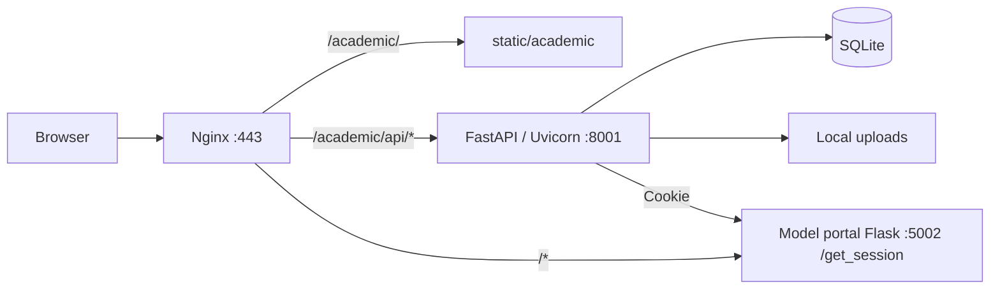

# Architecture

## Deployment Modes

The same codebase supports two layouts:

1. **Standalone**: Nginx serves `/` and proxies `/api/` to Uvicorn on `127.0.0.1:8000`.
2. **Model portal subpath**: Nginx serves `/academic/` and proxies `/academic/api/` to Uvicorn on
   `127.0.0.1:8001`. Uploads are served from `/academic/uploads/`.



## SSO Flow

The portal uses a Flask signed session cookie. The academic backend does not read the cookie itself:
it forwards the request's `Cookie` header to the portal's existing `GET /get_session` on localhost,
which returns `{username, role, sis_id}`.

```text
Browser (logged into portal)
  -> GET /academic/ (static SPA)
  -> POST /academic/api/v1/auth/sso (same-origin, browser sends portal cookie)
  -> FastAPI forwards Cookie to http://127.0.0.1:5002/get_session
  -> match academic user by student_id / username, or auto-provision
  -> issue academic JWT
```

Rules:

- Missing `username` in the session response means not logged in; return 401 with `login_url`.
- Match `student_id == sis_id` first, then `username`.
- Existing users keep their role and password; only an empty `student_id` may be filled.
- New users: portal `teacher` -> `advisor_teacher`, otherwise `student`; `is_active=true`.
- Never log or persist the portal Cookie or password.

## Backend Modules

- `app/main.py`: FastAPI app, lifespan (DB init, super-admin seed, optional KB scheduler), routers.
- `app/api/v1/`: `auth`, `colleges`, `partitions`, `teams`, `users`, `resources`, `reviews`, `stats`,
  `site_config`, `kb`.
- `app/models/`: users/teams/resources/reviews plus `kb.py` for knowledge bases, documents, versions,
  conflicts, ingestion jobs and knowledge points.
- `app/services/`: authentication and SSO, KB ingest/pipeline/sync/scheduler/Canvas.
- `app/database.py`: async SQLite engine with WAL, busy timeout and foreign keys.
- `app/utils/`: JWT/password utilities and auth dependencies.

## Frontend Modules

- `frontend/src/App.tsx`: routes; `BrowserRouter` uses `import.meta.env.BASE_URL`.
- `frontend/src/api/client.ts`: axios base `${BASE_URL}api/v1`; 401 retries SSO once.
- `frontend/src/contexts/AuthContext.tsx`: token bootstrap, SSO fallback, `localStorage.user` sync.
- `frontend/src/utils/path.ts`: upload path normalization with the deployment base.
- `frontend/scripts/postbuild.mjs`: injects legacy CSS/JS/data-entry, rewrites absolute paths to
  `/academic/`, copies the build into `static/`.

## API Surface

Active prefix: `/api/v1` (standalone) or `/academic/api/v1` (portal subpath).

- `auth`: register, verification code, login, `sso`, current user, change password.
- `colleges`, `partitions`, `teams`, `users`: organization and governance.
- `resources`: media CRUD, uploads, reviews, likes, reports, comments, images.
- `reviews`, `stats`: review queue and statistics.
- `site_config`: persisted page background configuration.
- `kb`: knowledge bases, documents/versions, conflicts, sources, jobs, search and stats.

## Static Site

`static/` is the current production snapshot and the home of the hand-written pages (`data.html`,
`editor.html`) and their JS/CSS. It contains the online React bundle patched for `/academic/` and SSO.
`frontend/` is a parallel source variant; `npm run build` writes only `frontend/dist/` by default.
Do not overwrite `static/` without a visual diff, and never delete it wholesale.
